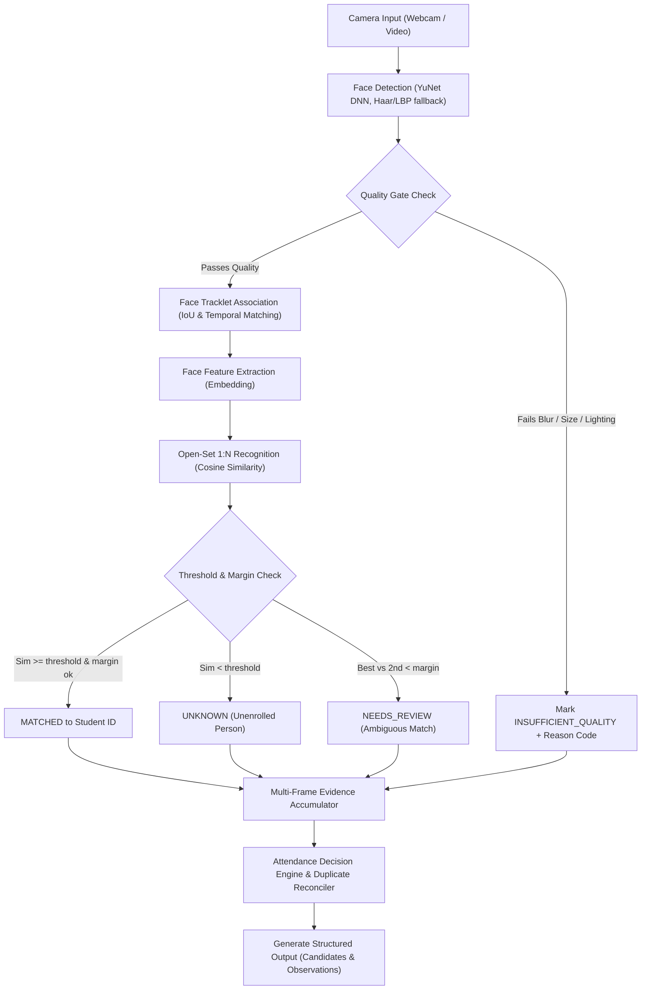

# RIT-Sync Vision — AI Engine Workflow Specification

**Author:** Paul Bryton Raj (AI & System Lead)  
**Version:** 1.0  

---

## 1. High-Level AI Pipeline Flow

The AI Engine processes input during a bounded capture window (30–120 seconds):

---

## 2. Decision Logic & Thresholds

| Parameter | Default Value | Purpose |
|---|---|---|
| `MIN_FACE_SIZE_PIXELS` | 48 pixels | Rejects distant/small faces that cannot be reliably recognized |
| `BLUR_THRESHOLD` | 80.0 | Minimum Laplacian variance to prevent motion blur misidentifications |
| `BRIGHTNESS_MIN` | 40.0 | Minimum luminance (prevents underexposed faces) |
| `BRIGHTNESS_MAX` | 225.0 | Maximum luminance (prevents blown-out/overexposed faces) |
| `COSINE_SIM_THRESHOLD` | SFace 0.363 / dev encoder 0.65 | Minimum similarity to match an enrolled student (calibrate with `scripts/evaluate_ai.py`) |
| `SECOND_BEST_MARGIN` | SFace 0.08 / dev encoder 0.10 | Distance between #1 and #2 match; prevents ambiguous assignment |
| `IDENTITY_CONSISTENCY` | 0.8 | Share of per-frame matches that must agree within one track |
| `CAPTURE_WINDOW` | 30–120 s | Bounded capture window (`SessionContext.duration_seconds`) |
| `MIN_EVIDENCE_FRAMES` | 3 frames | Minimum number of valid frames needed for `PRESENT_CANDIDATE` |

---

## 3. Candidate Outcome Matrix

| Observation Criteria | AI Candidate State | Reason Codes |
|---|---|---|
| $\ge 3$ usable frames, Sim $\ge$ threshold, margin ok | `PRESENT_CANDIDATE` | `[]` |
| $\ge 1$ usable frame, Sim $\ge$ threshold, but $< 3$ frames | `NEEDS_REVIEW` | `["INSUFFICIENT_EVIDENCE"]` |
| Sim $\ge$ threshold but margin too small | `NEEDS_REVIEW` | `["AMBIGUOUS_MATCH"]` |
| Same student on tracks seen at the same time | `NEEDS_REVIEW` | `["DUPLICATE_CANDIDATE", "CONFLICTING_IDENTITY"]` |
| Same student on tracks at different times (track fragmentation) | merged; `PRESENT_CANDIDATE` if pooled evidence suffices | `["DUPLICATE_CANDIDATE"]` |
| Per-frame identities disagree inside one track | `NEEDS_REVIEW` | `["CONFLICTING_IDENTITY"]` |
| Camera fault during session | present candidates downgraded to `NEEDS_REVIEW`; session `FAILED` | `["CAMERA_DISCONNECTED"]` |
| Templates from another model version | never compared | `["MODEL_VERSION_MISMATCH"]` |
| Low similarity to all enrolled templates | `UNKNOWN` (Track) | `["LOW_MATCH_CONFIDENCE"]` |
| Poor quality / blur / lighting | Unusable Track | `["IMAGE_BLUR"]`, `["FACE_TOO_SMALL"]`, etc. |
| Student on class roster never observed | `NOT_OBSERVED` | `[]` (Never `ABSENT`) |
